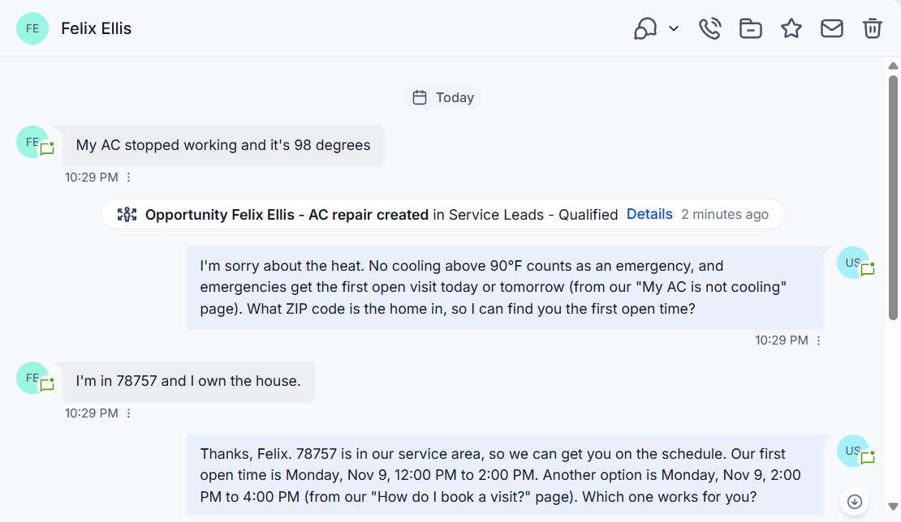
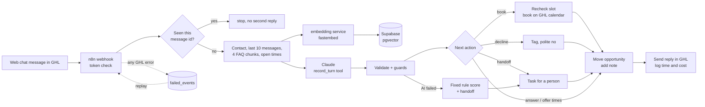
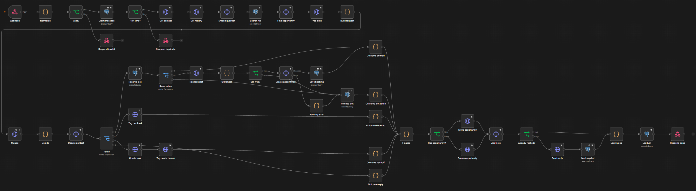
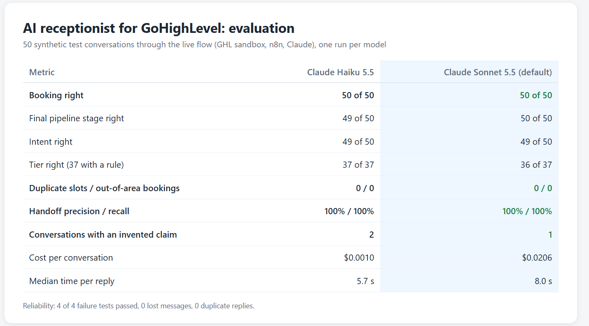
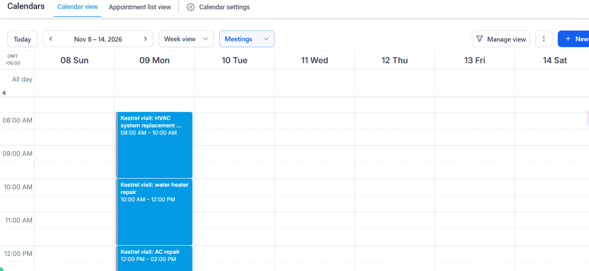
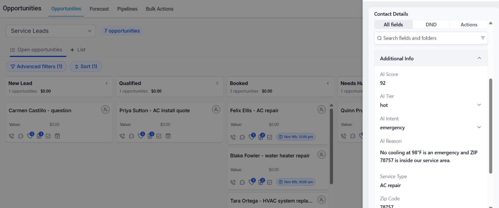
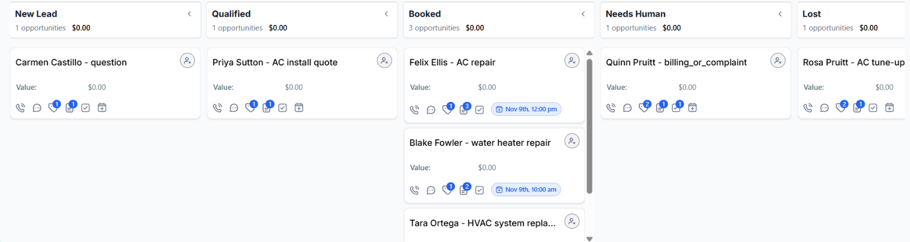

# AI receptionist for GoHighLevel

An AI agent that answers web chat leads inside GoHighLevel (GHL) for a home services company. It answers from the company FAQ, qualifies the lead, books the visit on the GHL calendar, moves the opportunity to the right pipeline stage and hands the conversation to a person when it should.

Kestrel Air & Plumbing (AC, heating and plumbing in Austin, Texas) is a made-up company. All names, emails and phone numbers in this project are synthetic.



## The problem

A plumbing or HVAC shop loses the lead that writes at 9 pm and gets no answer until the morning. Most GHL "AI bots" can answer questions, but they don't book a real slot, they don't keep the pipeline right, and nobody measures how often they make things up.

I built this to show the parts that matter to an agency that resells GHL: integration through the GHL API, a fixed rule for when the AI fails, guards the AI can't talk its way past, and a test report with real numbers.

## How it works



- Each customer message reaches an n8n webhook with the GHL message, conversation and contact ids. The webhook needs a token header.
- The message id goes into Postgres first. If it is already there, the run stops, so a retried webhook never sends a second reply.
- The flow reads the contact, the last 10 messages, the open visit times and the 4 FAQ chunks closest to the message. A small container next to n8n embeds the question with fastembed (`bge-small-en-v1.5`), and pgvector finds the chunks.
- Claude fills one tool call, `record_turn`: intent, service, ZIP code, urgency, homeowner or not, a score from 0 to 100, a tier, a one-sentence reason, the reply and the next action. The reply may only use facts from the FAQ chunks and names the article it used.
- A Code node checks the answer. A score out of range, an unknown intent, or a cited article that wasn't in the context means the AI answer is dropped: a fixed rule scores the lead from keywords and a person takes over.
- Four guards run in code, whatever the AI said: no times are offered before the ZIP code is known, a ZIP code outside the service area always gets a polite decline, a tenant never books an install, and a booking must name a time that is still open.
- Then the GHL actions: custom fields on the contact (score, tier, intent, reason, service, ZIP, urgency), a booking (the time is checked again right before), a tag and the Lost stage for a decline, or a task and the Needs Human stage for a handoff. The opportunity moves to New Lead, Qualified, Booked, Needs Human or Lost, and gets a note with the score and the reason.
- Before a booking, the slot is reserved in Postgres (one row per calendar and start time), so two conversations can't take the same time even if they confirm in the same second.
- The reply goes out last, and the flow records that it was sent. If any GHL call fails, the error workflow saves the original payload to `failed_events`, and `scripts/replay_failed.py` runs it again. A replay never sends a second reply or books a second visit for the same message.



## Results

I wrote 50 test conversations of 1 to 4 customer messages, at least 5 for each line of the business rule table, with the expected outcome for each one in `data/expected.csv`. I ran all 50 through the live flow (GHL sandbox, n8n, Claude) once per model. Full report: [docs/report.md](docs/report.md).

| Metric | Claude Haiku 5.5 | Claude Sonnet 5.5 |
|---|---|---|
| Booking right (booked when it should, not when it should not) | 50 of 50 | 50 of 50 |
| Final pipeline stage right | 49 of 50 | 50 of 50 |
| Intent right | 49 of 50 | 49 of 50 |
| Tier right (37 conversations where the rule sets one) | 37 of 37 | 36 of 37 |
| Duplicate slots in the calendar | 0 | 0 |
| Out-of-area bookings | 0 | 0 |
| Handoff precision and recall | 100% and 100% | 100% and 100% |
| Conversations with an invented claim | 2 | 1 |
| Cost per conversation | $0.0010 | $0.0206 |
| Median time per reply, in the flow | 5.7 s | 8.0 s |



Invented claims are checked by Claude Sonnet 5.5, which reads every reply next to all 25 FAQ articles and lists the business facts they don't support. I also read 10 random replies myself and agreed with it on all 10.

**Default model: Claude Sonnet 5.5.** My rule was the cheapest model that passes every acceptance check. Haiku is 20 times cheaper and faster, but it had 2 conversations with an invented claim against a limit of 1, and one of them told a customer to call a phone line the company doesn't publish. A wrong fact sent to a customer costs more than 2 cents.

This was the second full run. The first one found real problems: the prompt promised a reply time the FAQ only gave for billing questions, the maintenance plan article was hard to find, and the ZIP guard only fixed part of the out-of-area cases. I fixed those and ran everything again. Both runs are in `data/`.







## Reliability

`scripts/reliability_test.py` breaks one thing at a time on the live flow and puts it back afterwards.

| Test | What happened |
|---|---|
| Invalid Claude API key | The fixed rule scored the lead (80, hot, from the emergency words), sent one reply, created a task for a person and moved the card to Needs Human. |
| GHL API answering with errors | The message went to `failed_events` with its payload. After the token was back, the replay finished it, with one reply. |
| Offered time taken before the customer confirms | No booking on the taken time. The agent said it was no longer open and offered the next two. |
| Same message delivered twice at the same moment | One run answered, the other stopped as a duplicate. One reply. |

0 lost messages and 0 duplicate replies across the 4 tests.

## Run it yourself

You need Python 3.11, a GHL account with a sub-account (I used a Marketplace developer sandbox), a self-hosted n8n with the public API on, an Anthropic API key and a Supabase project with pgvector.

1. Install:

   ```bash
   python -m venv .venv
   source .venv/bin/activate   # Windows: .venv\Scripts\activate
   pip install -r requirements.txt
   ```

2. Copy `.env.example` to `.env` and fill it in: `GHL_TOKEN` (a sub-account Private Integration Token with the scopes in `docs/setup-ghl.md`), `GHL_LOCATION_ID`, `N8N_BASE_URL`, `N8N_API_KEY`, `ANTHROPIC_API_KEY`, `LLM_MODEL`, `DATABASE_URL` (Supabase session pooler), `INBOUND_TOKEN` (any long random string) and `EMBED_URL`.
3. Set up GHL. The pipeline is made by hand (steps in `docs/setup-ghl.md`), the script does the rest:

   ```bash
   python scripts/check_env.py
   python scripts/setup_ghl.py
   ```

4. Load the FAQ and start the embedding service next to n8n (`docs/server.md`):

   ```bash
   python scripts/load_kb.py
   ```

5. Create the n8n credentials and publish the two workflows:

   ```bash
   python scripts/setup_n8n.py
   python scripts/deploy_n8n.py
   ```

6. Play the test conversations, run the eval and write the report:

   ```bash
   python scripts/chat.py --smoke
   python scripts/run_eval.py
   python scripts/report.py
   python scripts/reliability_test.py
   ```

`python scripts/reset_demo.py` deletes every test contact (tag `ai-test`) with its visits and opportunities. `python scripts/export_n8n.py` saves the live workflows back to `n8n/` with markers in place of ids and secrets.

To connect the real GHL web chat, add a GHL workflow with the "Customer Replied" trigger and a webhook action that posts the same four ids to the n8n webhook with the token header.

A Snapshot of the sub-account (pipeline, calendar, custom fields and tags) exists in my sandbox. Without it, `docs/setup-ghl.md` plus `scripts/setup_ghl.py` rebuild the same setup.

## Notes

- The GHL developer sandbox can now create Private Integration Tokens. Older docs said it could not.
- Sandbox API limit: 25 requests per 10 seconds and 10,000 per day, per location.
- The new sub-account had 0 users, so I gave the agency user access to it.
- Channel: GHL web chat. `POST /conversations/messages/inbound` with type `Live_Chat` adds the customer message and `POST /conversations/messages` sends the reply. Both show in the Conversations inbox. No custom provider was needed, and web chat needs no A2P or email setup.
- A Private Integration Token cannot create pipelines (401, scope not authorized). I made the pipeline in the GHL screen and the setup script reads its ids. Steps are in `docs/setup-ghl.md`.
- The create calendar route stored a 2-hour slot as 0.03 hours. I send 120 minutes instead.
- A round robin calendar also applies the user's own working hours, which default to Monday to Friday, so Saturday had no slots. I use an event calendar, which follows only its own open hours.
- n8n cannot run fastembed, so a small container on the n8n server embeds each question (`embed/`, steps in `docs/server.md`). The KB loader and the container use the same model.
- The Postgres credential checks Supabase's certificate. The n8n server trusts Supabase's root CA through `NODE_EXTRA_CA_CERTS` instead of skipping the check.
- Claude Haiku 5.5 takes a forced tool call. Claude Sonnet 5.5 rejects `tool_choice` `tool` with a 400, so for Sonnet the flow sends `auto` with a strict tool schema.
- Strict tool schemas reject an `enum` that lists `null`; the optional `urgency` field uses `anyOf` with a null type.
- In n8n 2.26 the error workflow only runs when it is active, so the deploy script activates both workflows.
- The test scripts play the customer: they store each message in GHL through the API and then call the n8n webhook with the same ids that a GHL workflow webhook would send.
- The n8n retry is a fixed wait (3 or 4 tries, 1 to 3 s apart), not an exponential backoff. With the sandbox limit of 25 requests per 10 s that is enough for one conversation at a time. Creating an appointment is not retried, so a timeout can't book twice.
- GHL's opportunity search lags a few seconds behind updates. Inside a conversation the turns are far enough apart, and no contact ended with two opportunities, but the eval reads the final stage 30 s after the last conversation.
- The demo calendar only has Monday to Saturday, 8 am to 6 pm. When the first day fills up, an emergency gets the first open time, which can be later than the "today or tomorrow" the FAQ promises. A real shop would add an on-call calendar.
- The docs list `Version: v3` for the message routes. `2021-07-28` also works, so I use one version for every call.
